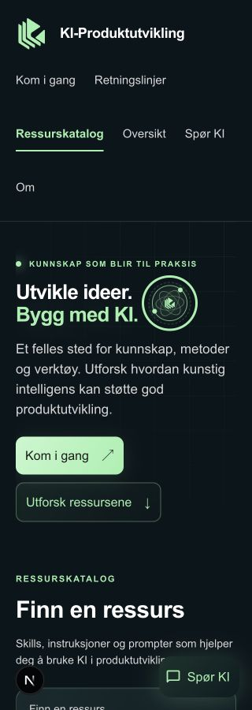

# Responsiv forsideillustrasjon

17. november 2026 · Codex (OpenAI), uten underagenter. Arbeidskopi basert på 8c8436a9. Nettleserprøve på eksisterende utviklingsserver http://127.0.0.1:3000/, ikke Docker-portalen på 3005.

## Endring

Overskriften og illustrasjonen deler nå en rad ved bredder opptil 950 px. Overskriften beholder to linjer, mens illustrasjonens kvadratiske mål beregnes fra samme skriftstørrelse og linjehøyde (2 × 1,09). Logo, ringer og bevegelsesradius skaleres med flaten, inkludert den ytre ringen. På skrivebord beholdes tidligere absolutte plassering og størrelse. Avsnitt og knapper følger etter overskriftsraden.

Førtesten ved 768 px viste overskrift y=299/h=103,80, knapper y=502,80 og illustrasjon y=592,80/h=230: illustrasjonen lå under knappene. Etter retting ligger den ved overskriften, før avsnitt og knapper. Den lille fontavrundingen mellom høydene er under 0,01 px.

## Faktisk DOM-kontroll

| Visningsbredde | Overskriftshøyde | Illustrasjonshøyde | Plassering                      | Vannrett rulling |
| -------------: | ---------------: | -----------------: | ------------------------------- | ---------------- |
|            320 |            56,67 |              56,68 | Til høyre, samme topp           | Nei              |
|            375 |            62,13 |              62,13 | Til høyre, samme topp           | Nei              |
|            560 |            92,78 |              92,77 | Til høyre, samme topp           | Nei              |
|            768 |           127,23 |             127,24 | Til høyre, samme topp           | Nei              |
|            950 |           139,52 |             139,52 | Til høyre, samme topp           | Nei              |
|           1024 |           138,39 |                280 | Eksisterende skrivebordsoppsett | Nei              |
|           1440 |           174,39 |                340 | Eksisterende skrivebordsoppsett | Nei              |

Ved 320 px: Enter på animasjonsknappen satte data-paused=true, animation-play-state=paused og etiketten «Start animasjonen i forsideillustrasjonen». Mellomrom startet den igjen med data-paused=false, running og «Pause animasjonen i forsideillustrasjonen». Fokus ble på hero-art-knappen i begge tilfeller. Den minste målte knappen er 56,68 × 56,68 px. Ingen ny skjermleser- eller full WCAG-vurdering; eksisterende prefers-reduced-motion-regel er beholdt.

Ett representativt skjermbilde er bevart ved faktisk 320 × 900 px (nettleserens skjermbilde fulgte siste malte mobilramme). De øvrige størrelsene er DOM-målinger; de er ikke påstått dokumentert med egne bilder.

SHA-256 for bildet: `9b65d92b51a2c3876f2e804fd772fd745a828175a7c1b8c9bc1c34f940fd3534`.

## Kontroller og begrensninger

- pnpm test:search: 126/126 bestått, inkludert nytt spørsmål om plasseringen fra funksjonsregisteret og kontroll av faktainnholdet. Ingen rangering eller tidligere forventninger endret.
- pnpm typecheck, pnpm test:content-sync, pnpm format:check, pnpm test:links (239 filmål i 12 dokumenter) og git diff --check bestod.
- Et separat forsøkt lokalmiljø på 3040 startet ikke fordi Next allerede kjørte på 3000; denne eksisterende serveren ble brukt og beholdt. Ingen eksisterende prosess ble stoppet.
- Ingen Docker-ombygging, modellkall, blindmåling, priskildekall, commit eller push. Endringen vises i lokal utvikling; Docker-bildet må bygges på nytt for å vise den der. Midlertidig nettleserbredde er tilbakestilt.
