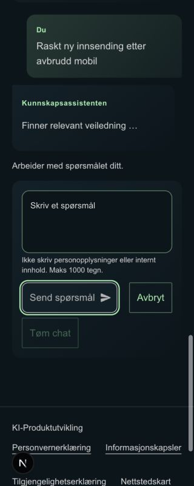

# Fokus i chatens Send-/Avbryt-flyt

11. november 2026 · Codex (OpenAI), uten underagenter. Node 24.22.1 / Next.js 16.4.3 på macOS. Tidligere ukommiterte endringer er bevart. Ingen blindsett eller test:blind brukes.

## Førtest og retting

Den nye gjengivelsestesten på faktisk ChatComposer feilet før retting: native disabled var til stede, aria-disabled manglet. I nettleseren ga tekstfelt → Tab → Send → Enter aktivt element BODY, mot BUTTON «Send spørsmål» før Enter. Dette bekrefter det dokumenterte fokusfallet i chat-dates-port-rapporten uten å endre den historiske rapporten.

Send er nå samme type=submit-knapp, med aria-disabled=busy og preventDefault ved aktivering mens busy. Native disabled fjernes, slik at fokus og tabulatorplassering beholdes. useChat sin controller.current-sperre er uendret og beskytter også før neste render. Avbryt står etter Send som egen type=button; fokus flyttes aldri automatisk dit. aria-busy på skjemaet og eksisterende rag-status beholdes.

Rene shouldIgnoreSend og focusTargetAfterRequest testes uten nye avhengigheter. Ved busy→idle brukes ownerDocument.activeElement: Send/body gir tekstfelt; felt, annen kontroll, lenke eller null gir ingen flytting. Ingen flytting på første render eller ved start. Avbryt som fjernes fra DOM etter aktivering gir body og dermed feltfokus via samme avgjørelse. Dette unngår ubetinget fokusstjeling når brukeren har valgt noe annet.

## Nettleserkontroll

Integrert nettleser, isolert midlertidig prosjektkopi med Next dev/webpack og lokal simulert JSON-transport. Ingen .env kopiert, ingen ekte modell-/priskildekall, og vanlige tjenester på 3000/3001/3005 er ikke endret. Langsom simulering holder forespørselen åpen til avbrudd; svarprøvene bruker 3 s. En første innsending rett etter oppstart traff før klienten var hydrert (normal skjema-navigasjon); den er ikke regnet som bestått prøve. Etter klientoppstart ble flytene kjørt på nytt.

| Steg                               | document.activeElement ved 1280 × 900 | document.activeElement ved 320 × 800 |
| ---------------------------------- | ------------------------------------- | ------------------------------------ |
| Felt → Tab før innsending          | BUTTON, Send spørsmål                 | BUTTON, Send spørsmål                |
| Enter på Send, busy=true           | BUTTON, Send spørsmål                 | BUTTON, Send spørsmål                |
| Ny rask Enter, busy fortsatt true  | BUTTON, Send spørsmål                 | BUTTON, Send spørsmål                |
| Tab under venting                  | BUTTON, Avbryt                        | BUTTON, Avbryt                       |
| Enter på Avbryt, busy=false        | TEXTAREA, spørsmålsfeltet             | TEXTAREA, spørsmålsfeltet            |
| Ny innsending etter avbrudd        | BUTTON, Send spørsmål                 | BUTTON, Send spørsmål                |
| Fullført simulert svar             | TEXTAREA, spørsmålsfeltet             | TEXTAREA, spørsmålsfeltet            |
| Flytt til bunnlenken under venting | A, Personvernerklæring                | A, Personvernerklæring               |
| Svar etter at lenken er valgt      | A, Personvernerklæring                | A, Personvernerklæring               |

En første mobilobservasjon av lenkefokus endte senere i MAIN#innhold, uten påvist årsak. Etterprøving i samme miljø viste A «Personvernerklæring» både under venting og etter ferdig svar. Dette er dokumentert som en avvikende utviklingsobservasjon, ikke som et bekreftet nytt avvik i fokusfunksjonen. Ekte dobbeltklikk på Send ved desktopbredde ble også prøvd: fortsatt BUTTON «Send spørsmål» med busy=true, deretter Tab til Avbryt, avbrudd til feltet og ny innsending med fullført svar.

Feltets faktiske genererte id i prøven var _R_29bn5rfllb_. Under venting var Send aria-disabled=true, native disabled=false; etterpå aria-disabled=false. Andre Enter avbrøt ikke forespørselen. Enter på Avbryt ga «Forespørselen ble avbrutt.», og ny innsending svarte normalt. 320 px hadde scrollWidth=320, uten horisontal overflyt.

Venteknappens ferdige beregnede stil var tekst/kant rgb(215,215,215), bakgrunn rgb(16,33,41), opacity=1. WCAG-luminansberegning gir **11,47:1** mot surface og **12,86:1** mot background. Kant mot begge endepunktene i skjemaets mørke gradient er dermed over 3:1; tekst mot knapp er 11,47:1. Fokusmarkeringen beholdes. Stil under CSS-overgang brukes ikke som sluttmåling.

## Kontroller og begrensninger

pnpm test bestod med **263/263 Node-tester**, **3/3 Python-tester**, faktisk innholdssynk og lenkekontroll. pnpm typecheck og pnpm build bestod. Etter dokumentoppdatering bestod pnpm format:check, git diff --check og lenkekontroll av 190 relative filmål i 11 dokumenter. Testkopi/testservere er fjernet, viewport er nullstilt og testfanen lukket. Skjermleser er ikke testet. Ingen full WCAG-godkjenning, fysisk mobil, andre nettlesermotorer, reell modell, Docker/Node 22, Pages-bygg, commit eller push. Én rapport og ett skjermbilde; ingen gjentatte rålogger lagres i repoet. Beta og åpne produksjonskrav videreføres.
