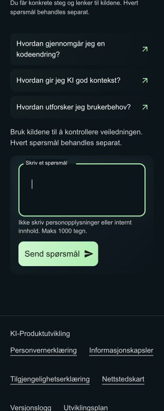

# Flytende etikett i Spør KI – 13. november 2026

Utført av Codex (OpenAI). Denne rettingen erstatter løsningen med fast etikett dokumentert i chat-label.md; den eldre rapporten bevares som historikk.

Brukeren ønsket den opprinnelige MUI-etiketten: teksten inne i tomt felt, med overgang til øvre ramme ved fokus eller innhold. Etiketten er gjenopprettet. Bare løftet etikett får feltets bakgrunnsfarge, slik at rammelinjen ikke synes bak teksten. Ingen endring i overgang, posisjon eller chatlogikk.

| Docker-kontroll             | Resultat                                                     |
| --------------------------- | ------------------------------------------------------------ |
| 1280 px, tomt og uten fokus | data-shrink=false, transparent bakgrunn, tekst inne i feltet |
| 1280 og 320 px, fokus       | data-shrink=true, bakgrunn rgb(9,21,27), tekst over rammen   |
| 320 px, innhold uten fokus  | Etiketten forblir løftet                                     |
| 320 px, tømt og uten fokus  | data-shrink=false, masken fjernet                            |
| Horisontal overflyt         | Ingen ved noen av breddene                                   |

Kontroller: pnpm test (276/276 Node, 3/3 Python, faktisk innholdssynk og lenkekontroll), pnpm typecheck, pnpm format:check og git diff --check bestod. Docker-produksjonsbygg og omstart bestod; nettleserprøven brukte http://127.0.0.1:3005/spor. Ingen modellforespørsel var nødvendig. Ingen skjermleserprøve, blindsett eller full tilgjengelighetsgodkjenning. Ingen commit eller push.
