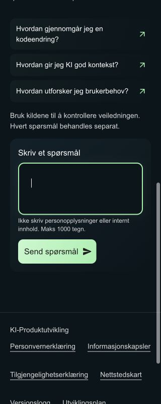

# Fast etikett i Spør KI

13. november 2026 · Codex (OpenAI), uten underagenter. Eksisterende ukommiterte arbeid bevart.

## Funn og retting

Brukerens skjermbilde viste feltkanten gjennom den flytende etiketten. Gjenskapt ved fokus i nettleseren: label top/bottom 269,5/286,75 px mot feltets topp 278,5 px, altså overlapp. Rammen hadde et MUI-legend, men den visuelle label-/rammetilpasningen ga ikke fri plass til teksten.

ChatComposer bruker nå en fast synlig label før TextField, koblet med htmlFor/id. Ingen flytende etikett beholdes. Dette unngår avhengighet av MUI-temaets notch-geometri og følger mønsteret som allerede brukes av katalogsøket. Den tilgjengelige betegnelsen er fortsatt «Skriv et spørsmål» og eksisterende helper-/feiltekst og fokusregler beholdes. Samme komponent dekker hele chattsiden og kompakt forsidechat.

## Avgrenset nettleserkontroll

Utført i integrert nettleser mot lokal Next dev på port 3000. Ingen gyldige spørsmål ble sendt til modell/API; «aa» ble avvist av klientens validering.

| Bredde  | Tilstand          | Avstand fra label til ramme | Resultat                                 |
| ------- | ----------------- | --------------------------: | ---------------------------------------- |
| 1280 px | Tomt, fokusert    |                        8 px | Ingen overlapp                           |
| 1280 px | Utfylt, to linjer |                        8 px | Ingen overlapp                           |
| 1280 px | Valideringsfeil   |                        8 px | Ingen overlapp; feiltekst vises          |
| 1280 px | Klikk på etikett  |                        8 px | TEXTAREA får fokus                       |
| 320 px  | Tomt, fokusert    |                        8 px | Ingen overlapp eller horisontal overflyt |
| 320 px  | Utfylt, to linjer |                        8 px | Ingen overlapp eller horisontal overflyt |

## Kontroller

Fokuserte komponent-/fokustester bestod 8/8, inkludert riktig koblet etikett i vanlig/busy-tilstand. pnpm typecheck bestod. pnpm test bestod med 276/276 Node-tester, 3/3 Python-tester, faktisk innholdssynk og 198 relative filmål i 11 dokumenter. Docker-produksjonsbygg og omstart bestod. I den faktiske Docker-portalen ble samme 8 px klaring bekreftet på chattsiden ved 320 px og i forsidechatten ved 1280 px, uten horisontal overflyt. Midlertidig viewport er nullstilt og testfanen lukket. pnpm format:check og git diff --check bestod etter dokumentoppdatering. Dette er ikke en skjermlesertest eller full tilgjengelighetsvurdering. Ingen blindsett eller test:blind.

